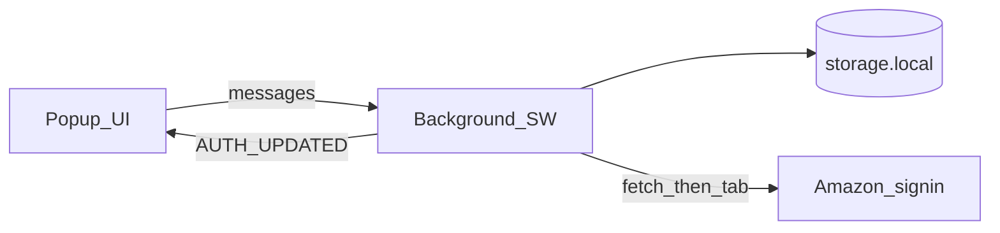

# Amazon Account Detector — Implementation Plan

## Goals

From [REQUIREMENTS.md](REQUIREMENTS.md) (extended beyond its five sample domains to **all current Amazon retail storefronts**), Approach with hybrid detection, and UX/i18n additions:

- Popup marketplace dropdown for all retail domains, plus an **All** table view
- Logged-in / not + email via hybrid detection without stealing focus
- Per-marketplace cache; **local-timezone last-check** + refresh control (spinner while in-flight)
- Persist last marketplace, language, and cache across browser restarts with `browser.storage.local`
- Runtime i18n for **13 locales** (see list below), browser language preselect, English fallback, user override, **RTL for Arabic**

## Architecture

- Background SW owns detection; popup is a thin client
- Hybrid: fetch sign-in HTML and parse; if indeterminate, inactive tab + `scripting.executeScript`, then close tab
- WXT + TypeScript + pnpm; vanilla popup
- Idempotent checks: per-marketplace in-flight map; **join** duplicates (no supersede); skip stale/`unknown` cache overwrites; persist fallback tab IDs and close orphans on SW restart

## Persistence (survives browser restart)

`browser.storage.local` **survives browser quit/reopen.** Use it for all prefs and auth cache. Do not use `storage.session` or SW memory-only for anything the user expects to keep.

| Key                     | Purpose                                                                                                                                |
| ----------------------- | -------------------------------------------------------------------------------------------------------------------------------------- |
| `selectedMarketplaceId` | Last dropdown selection (`all` or marketplace id); default `amazon.com`                                                                |
| `locale`                | User language override; if unset, resolve from browser UI language                                                                     |
| `authByMarketplace`     | Map id to `{ status, email?, checkedAt, source? }`                                                                                     |
| `fallbackTabIds`        | Inactive-tab IDs in use; orphan sweeps close unclaimed ones after SW restart; `userClaimed` entries stay until the user closes the tab |

On popup open: load prefs + cache → render → trigger background refresh via coordinator.

## Marketplaces, flags, All

[utils/marketplace/marketplaces.ts](../utils/marketplace/marketplaces.ts): full retail list (Americas, EMEA/India, Asia-Pacific; exclude non-retail / retired storefronts such as `amazon.cn`). Each entry includes `id`, `domain`, `suffix`, `assocHandle`, `countryCode` (ISO alpha-2).

- Dropdown: flag emoji from `countryCode` in front of each item (e.g. US flag + United States)
- First option: **All** — card list of every marketplace (flag/region, status, email, last checked; grouped by geo)
- All refresh: parallel checks with **concurrency limit 5** through the same coordinator (row updates as each finishes); tab fallback gated to **1** at a time

### Global refresh lock during All batch

While an **All** refresh is in progress (including the queue beyond the current 5):

- Disable **Refresh all** and every per-marketplace / single-view refresh control
- Background treats this as a single batch job (`allRefreshInFlight = true`) exposed via `GET_POPUP_STATE` / push events
- Reject or no-op standalone `CHECK_AUTH` for an individual marketplace until the All batch completes (coordinator already joins duplicates; UI lock prevents user-triggered extras)
- Re-enable all refresh controls only when the full All batch finishes (success or error)

This prevents: user opens All → first 5 start → user switches to another marketplace and hits refresh → duplicate work when the pool advances.

## Detection

1. Build sign-in URL from [REQUIREMENTS](REQUIREMENTS.md) pattern + per-marketplace `openid.assoc_handle` (`{cc}flex`, UK → `gbflex`; Singapore → `spflex` — verify with `pnpm verify:assoc-handles`, which curls then falls back to Chromium for WAF/`missing`; match requires the handle ≥2× in HTML to avoid probe-URL echo; wrong handles may yield more unknowns)
2. Fetch + [utils/auth/parse-auth.ts](../utils/auth/parse-auth.ts) → logged_in + email | logged_out | indeterminate
3. Indeterminate → inactive tab scrape → close tab (track ID in `fallbackTabIds`)
4. Persist definitive `logged_in` / `logged_out` (and first-paint `logged_out` seeds with `checkedAt: 0` — UI shows Signed out + “Never checked”, not Unknown). Within **1h** of `checkedAt`, indeterminate `unknown` sets `lastKnown` instead of wiping email; after 1h demote to `unknown` (on failed check or `ensureAuthCacheSeeded` expiry). Header “Checked just now” only when `checkedAt` advanced vs the refresh-start snapshot. Fallback tabs use an `aad_fb` marker + blank→track→navigate; orphan sweeps query Amazon host URL patterns only, close tracked auth-path tabs if Amazon strips the marker, and briefly close recent tracked Amazon storefront redirects (SW death mid-check). If the user focuses a fallback tab, it is marked `userClaimed` and **never** auto-closed later (deviation from “close on later inactive sweep” — ownership transfers to the user until they close the tab). All-refresh uses best-effort pooling so one marketplace failure records `unknown` and does not abort the batch.

## Popup UX

- Preselect last marketplace from storage; else `amazon.com`
- Single view: status, email, **last checked** via `Intl.DateTimeFormat` in **local timezone** using active UI locale; refresh button to the right of freshness
- Refresh: icon idle; spinner + disabled while that scope is in-flight; **also disabled when All batch lock is active**
- Language preference lives under **Settings** (flag + name options; on change save `locale`, set `dir`, re-render)
- All view: cards (geo sections + status filters) + Refresh all (spinner/disable for entire All batch duration)
- No proactive TTL refresh while the popup is closed; open/select triggers stale-while-revalidate
- While the popup stays open, auto-refresh the current selection every **30 minutes** (skips if a check is already in flight)

## Internationalization

Supported locales (ISO 639-1) and RTL, ordered by estimated total speakers (L1+L2):

| ISO 639-1 | RTL | Representative flag |
| --------- | --- | ------------------- |
| en        | No  | US                  |
| hi        | No  | IN                  |
| es        | No  | ES                  |
| ar        | Yes | SA                  |
| fr        | No  | FR                  |
| pt        | No  | PT                  |
| de        | No  | DE                  |
| ja        | No  | JP                  |
| tr        | No  | TR                  |
| it        | No  | IT                  |
| pl        | No  | PL                  |
| nl        | No  | NL                  |
| sv        | No  | SE                  |

- Catalogs under `locales/*.json` for every code above; runtime [utils/i18n/i18n.ts](../utils/i18n/i18n.ts) (needed for runtime language switch; `chrome.i18n` alone cannot switch live)
- Each locale entry includes `rtl: boolean` and `flagCountryCode` for the language dropdown
- Resolve: stored `locale` if supported → else `browser.i18n.getUILanguage()` mapped to base tag → else `en`
- **RTL**: when active locale has `rtl: true` (Arabic), set `document.documentElement.dir = "rtl"` (and `lang`); for LTR locales set `dir = "ltr"`. Layout/CSS must be logical (`margin-inline`, flex order) so the popup mirrors correctly
- Manifest `default_locale: en` + minimal `_locales/en` for extension name/description only

## Messaging and permissions

Typed messages in [utils/messaging/messages.ts](../utils/messaging/messages.ts): `GET_POPUP_STATE`, `SET_MARKETPLACE`, `SET_LOCALE`, `CHECK_AUTH`, push `AUTH_UPDATED` / in-flight status including `allRefreshInFlight`.

[wxt.config.ts](../wxt.config.ts): `storage`, `tabs`, `scripting` + host permissions only for supported Amazon retail origins.

## Tooling / finish checklist

- Vitest tests: URL builder, parse fixtures, cache, i18n resolve (incl. RTL flag), coordinator, All concurrency + global lock
- ESLint + Prettier; scripts `format`, `lint`, `lint:fix`, `test`
- `pnpm build` / `compile` green; README covers All view, language/RTL, hybrid non-disruptive check

## Implementation order

1. Tooling + marketplaces + URL builder tests
2. parse-auth, auth-cache, check-coordinator + tests
3. detect-auth + background messaging + permissions (incl. All batch + global lock state)
4. i18n catalogs (13 locales) + locale resolve/persist + RTL `dir`
5. Popup single-marketplace UI (marketplace flags, language flags, local-TZ time, refresh spinner)
6. All cards + parallel refresh + UI/SW global refresh lock
7. Remove content stub; README; format/lint/test/build

## Implementation todos

- [x] Add vitest/eslint/prettier; implement marketplaces + URL builder + tests
- [x] Implement parse-auth, auth-cache, idempotent check-coordinator + tests
- [x] Hybrid detect-auth + background messaging + host permissions
- [x] 13 locales (en/hi/es/ar/fr/pt/de/ja/tr/it/pl/nl/sv), language flags, RTL dir, persist override
- [x] Popup: last marketplace, flags, local-TZ timestamp, refresh spinner UX
- [x] All cards + parallel refresh (concurrency 5) with global refresh lock until batch done

## Out of scope

Server sync, Seller Central/AWS, `amazon.cn`, Firefox-specific polish beyond existing WXT scripts.
